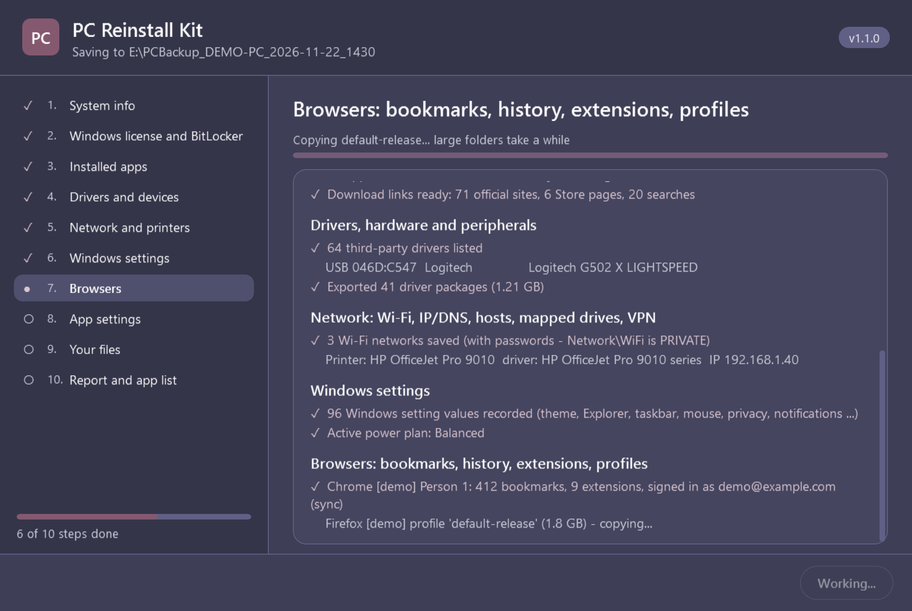
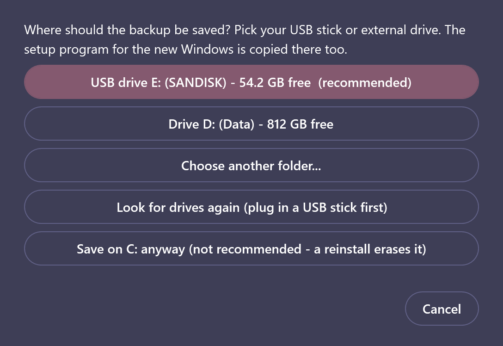
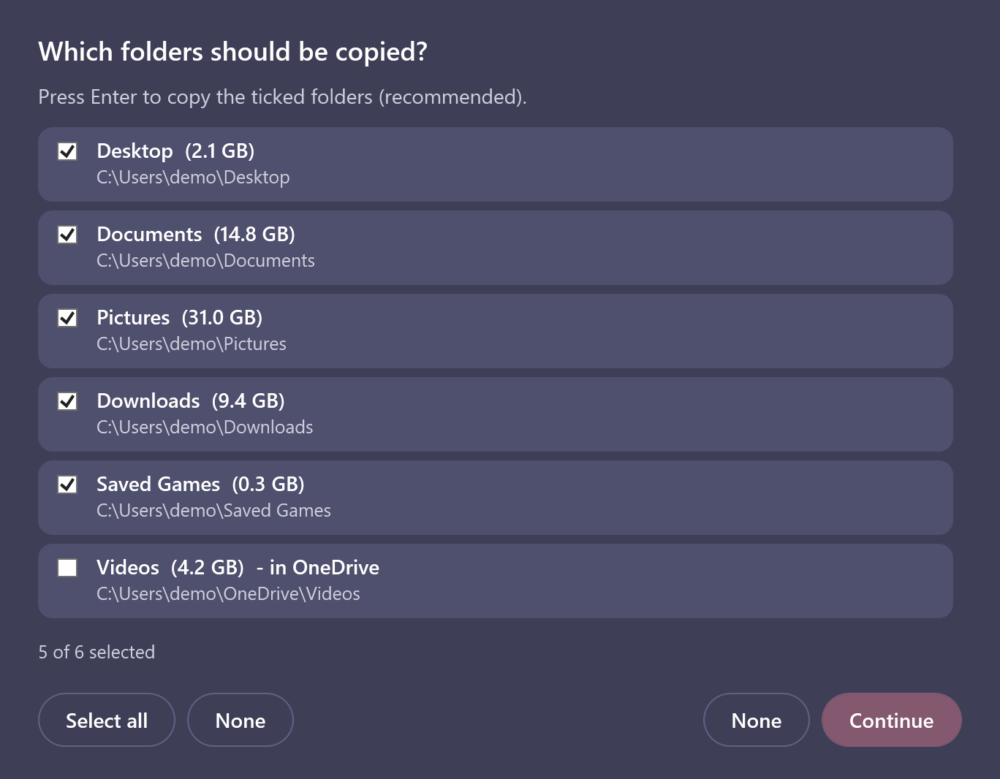
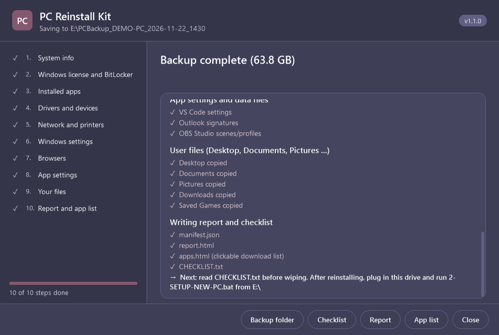
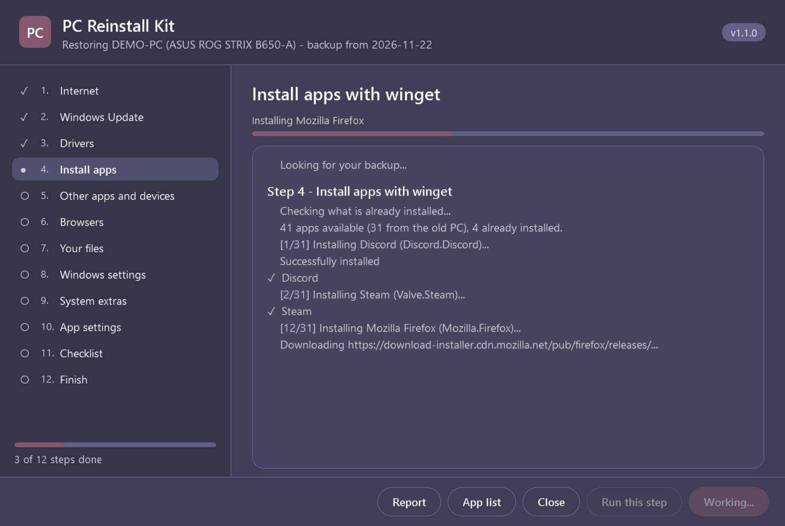
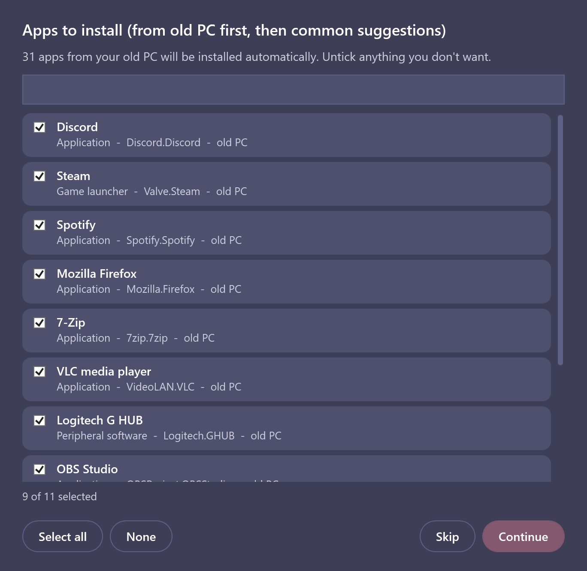
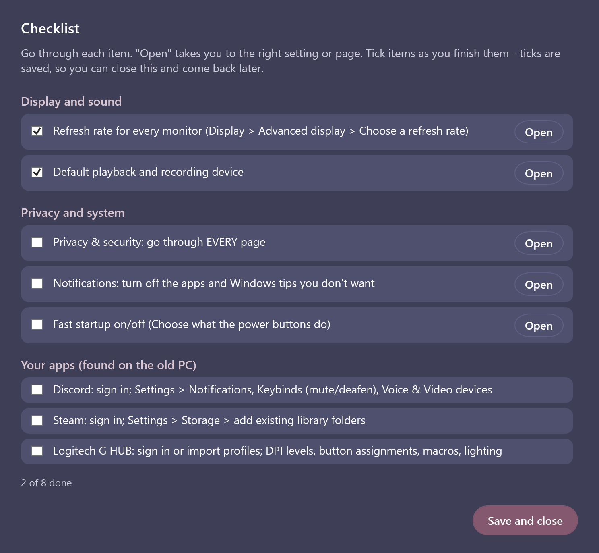
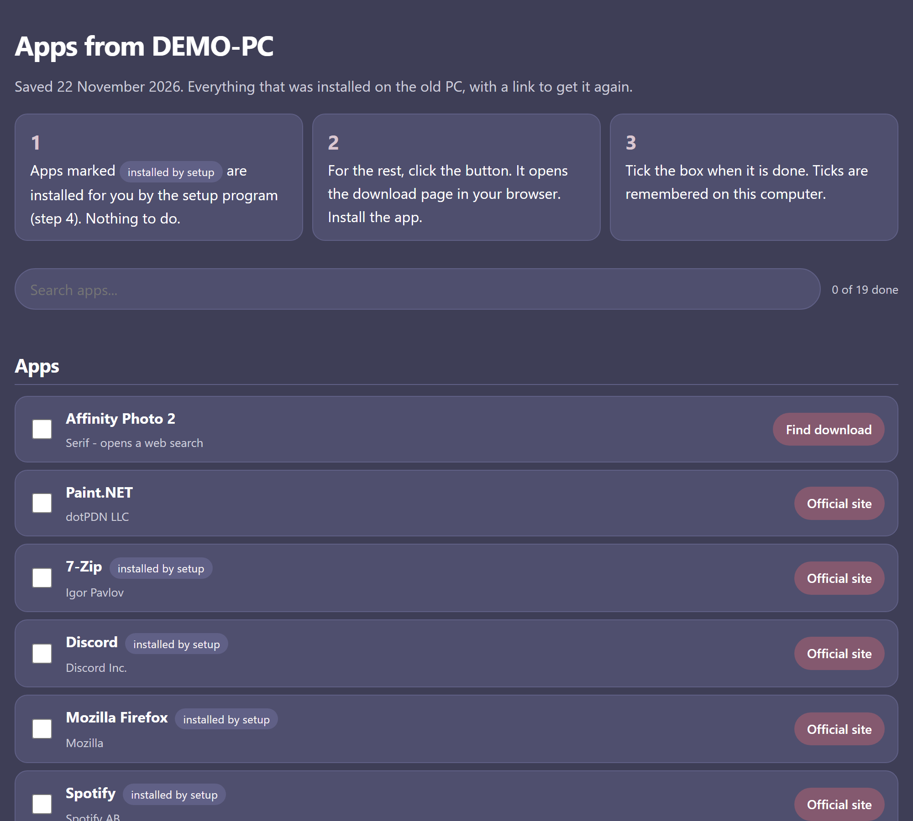
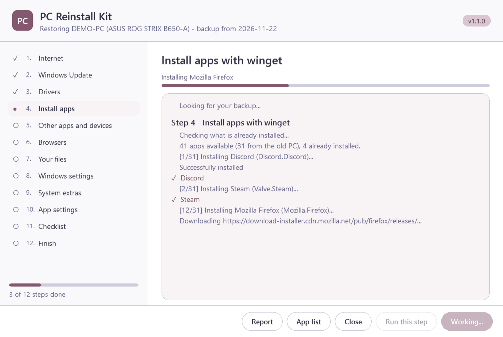

# PC Reinstall Kit

Two Windows scripts for reinstalling Windows without losing anything:

1. **Before wiping:** `1-BACKUP-OLD-PC.bat` records installed apps, drivers, settings, Wi-Fi networks, printers, browser bookmarks/extensions/profiles, app settings and (optionally) personal files. It writes a report, an app download list and a "before you wipe" checklist, and copies itself onto the backup drive so the drive is ready for the new PC.
2. **After reinstalling:** `2-SETUP-NEW-PC.bat` on that drive walks through setup step by step: internet and drivers, Windows Update, reinstalling apps automatically (winget), restoring browsers, files and settings, and a guided checklist.

Both run as a normal app window with a step list, progress bars and dialogs. If the window can't open, they fall back to a text console.

## Screenshots

**Backing up the old PC.** A step list on the left, live progress on the right.

<table>
<tr>
<td width="50%"> Pick where to save. USB drives come first, and the setup program is copied there too.</td>
<td width="50%"> Choose which folders to copy. Recommended ones are already ticked.</td>
</tr>
</table>

**Setting up the new PC.** Run everything in order, or click any step to redo it.

<table>
<tr>
<td width="50%"> Apps from the old PC are reinstalled automatically. Untick anything you don't want.</td>
<td width="50%"> The checklist: "Open" jumps to the right Windows setting. Ticks are saved.</td>
</tr>
</table>

<table>
<tr>
<td width="50%"> <code>apps.html</code>: every app with a button to get it again.</td>
<td width="50%"> Follows the Windows light/dark setting.</td>
</tr>
</table>

Screenshots use made-up demo data.

## Download

Grab **`pc-reinstall-kit.zip`** from the [latest release](../../releases/latest), unzip it onto a USB stick or external drive, and double-click `1-BACKUP-OLD-PC.bat`. `README.txt` has the details.

The highlighted button in every dialog is the recommended choice.

## Requirements

- Windows 10 or 11 (Windows PowerShell 5.1, built in)
- Administrator rights (it asks)
- winget / App Installer for automatic app installs (built into current Windows)

## Privacy

Everything stays on your drive. Nothing is uploaded anywhere. The backup folder contains private data (Wi-Fi passwords, browser data, optional password exports), so keep the drive safe. The setup's last step offers to delete those files.
